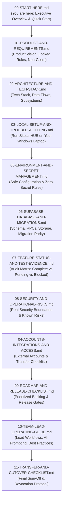

# SketchHUB — Lead Takeover Guide (`00-START-HERE.md`)

> **Target Audience:** Tharika ([tharikadheena@gmail.com](mailto:tharikadheena@gmail.com) / GitHub: `@tharikadheena-ui`)  
> **Outgoing Project Lead:** Harshanth (`@Hxrsh-ops`)  
> **Platform:** SketchHUB Campus Event Operations Platform  
> **Repository:** [https://github.com/Hxrsh-ops/sketch-events-app](https://github.com/Hxrsh-ops/sketch-events-app)  
> **Active Development Branch:** `feat/harshanth-main-development`  
> **Status:** Code complete for core milestones; ready for local verification, account delegation, remote migration alignment, and production cutover.

---

## 1. Quick Start: How to Run SketchHUB Right Now

If you want to immediately boot and explore the application on your Windows machine, run these commands in PowerShell:

```powershell
# 1. Clone & check out the active development branch
git clone https://github.com/Hxrsh-ops/sketch-events-app.git
cd sketch-events-app
git checkout feat/harshanth-main-development

# 2. Install dependencies cleanly
npm ci

# 3. Create your local environment file (starts in offline preview mode by default)
Copy-Item .env.example .env.local

# 4. Run static quality gates
npm run type-check   # Verifies TypeScript (0 errors)
npm run lint         # Verifies ESLint (0 errors)
npm test             # Runs 294 offline tests

# 5. Start development server
npm run dev
```

Open [http://localhost:3000](http://localhost:3000) in your browser.  
To run with live PostgreSQL, Auth, and Storage, launch Docker Desktop and run `npx supabase start` (detailed in [03-LOCAL-SETUP-AND-TROUBLESHOOTING.md](./03-LOCAL-SETUP-AND-TROUBLESHOOTING.md)).

---

## 2. Welcome & Purpose of This Handover

Welcome to the leadership of **SketchHUB**! 

SketchHUB is an admin-first event operations and participant management platform developed for campus events (originally designed for the SKETCH college club). Its core mission is to give organizers one calm, dependable, highly auditable workspace to publish events, manage registrations, coordinate live event-day check-in with fraud-proof rotating QR tickets, send transactional communications, and close out events with attendance records and certificates.

Previously, Harshanth led overall architecture, Supabase database migrations, security, and administrative workflows, while you owned the public registration experience and Pragadeesh worked on email outbox infrastructure. As the new Project Lead and Technical Owner, you are taking over complete responsibility for:
- Repository stewardship and branch merges.
- Local and remote Supabase database architecture and migrations.
- External integrations (Supabase, Google Cloud Console OAuth, Resend / Brevo, Vercel hosting, and background cron scheduling).
- Production release readiness, security boundaries, and operational reliability.

This handover package is designed so you can **independently run, test, understand, maintain, deploy, and govern SketchHUB** on your own laptop without needing Harshanth's computer, personal Google account, browser session cookies, or undocumented knowledge.

---

## 3. Reading Order for the Handover Package

Do not attempt to read everything at once. Read the documentation files in the `docs/handover/` directory in this exact sequence:



1. [**00-START-HERE.md**](./00-START-HERE.md) *(This file)*: High-level overview, reading order, and first 48 hours.
2. [**01-PRODUCT-AND-REQUIREMENTS.md**](./01-PRODUCT-AND-REQUIREMENTS.md): Product vision, target audience, locked design decisions, and strict non-goals (e.g., why students never get accounts).
3. [**02-ARCHITECTURE-AND-TECH-STACK.md**](./02-ARCHITECTURE-AND-TECH-STACK.md): Full architectural specification, tech stack versions, server actions, RPCs, and data flows.
4. [**03-LOCAL-SETUP-AND-TROUBLESHOOTING.md**](./03-LOCAL-SETUP-AND-TROUBLESHOOTING.md): Step-by-step Windows setup guide to run the app, local Docker Supabase, and Mailpit.
5. [**05-ENVIRONMENT-AND-SECRET-MANAGEMENT.md**](./05-ENVIRONMENT-AND-SECRET-MANAGEMENT.md): Strict security guardrails for environment variables, transfer matrix, and zero secrets in Git.
6. [**06-SUPABASE-DATABASE-AND-MIGRATIONS.md**](./06-SUPABASE-DATABASE-AND-MIGRATIONS.md): PostgreSQL schema, 8 database migrations, RLS policies, storage bucket rules, and migration parity.
7. [**07-FEATURE-STATUS-AND-TEST-EVIDENCE.md**](./07-FEATURE-STATUS-AND-TEST-EVIDENCE.md): Honest feature-by-feature completion matrix backed by actual automated test runs.
8. [**08-SECURITY-AND-OPERATIONAL-RISKS.md**](./08-SECURITY-AND-OPERATIONAL-RISKS.md): Real operational and cryptographic risks (rotating QR, outbox retries, rate limits).
9. [**04-ACCOUNTS-INTEGRATIONS-AND-ACCESS.md**](./04-ACCOUNTS-INTEGRATIONS-AND-ACCESS.md): Complete external account register and delegation steps.
10. [**09-ROADMAP-AND-RELEASE-CHECKLIST.md**](./09-ROADMAP-AND-RELEASE-CHECKLIST.md): Prioritized P0–P3 roadmap and production staging checklist.
11. [**10-TEAM-LEAD-OPERATING-GUIDE.md**](./10-TEAM-LEAD-OPERATING-GUIDE.md): Day-to-day lead operating guide, AI pair programming practices, and Antigravity master prompt.
12. [**11-TRANSFER-AND-CUTOVER-CHECKLIST.md**](./11-TRANSFER-AND-CUTOVER-CHECKLIST.md): Sign-off checklist and final transition verification.
13. [**HANDOVER-INDEX.md**](./HANDOVER-INDEX.md): Index summary, completion percentages, and outstanding verification gaps.

---

## 4. First-Day & First-48-Hour Priorities

### Day 1 (First 24 Hours)
- [ ] **Clone & Isolate**: Clone the repository to your own Windows machine on branch `feat/harshanth-main-development`.
- [ ] **Read Product & Architecture**: Review [01-PRODUCT-AND-REQUIREMENTS.md](./01-PRODUCT-AND-REQUIREMENTS.md) and [02-ARCHITECTURE-AND-TECH-STACK.md](./02-ARCHITECTURE-AND-TECH-STACK.md).
- [ ] **Run Offline Verification**:
  ```powershell
  npm ci
  npm run type-check   # Must exit with 0 errors
  npm run lint         # Must exit with 0 errors
  npm test             # Verify unit tests (294 pass offline; 17 DB tests skip gracefully)
  ```
- [ ] **Launch Local Docker Supabase**: Start Docker Desktop and run `npx supabase start`. Verify Studio at `http://127.0.0.1:54323` and Mailpit at `http://127.0.0.1:54324`.
- [ ] **Start Dev Server**: Launch `npm run dev` and explore the admin dashboard at `http://localhost:3000`.

### Day 2 (24 to 48 Hours)
- [ ] **Verify Storage & Ticket Studio**: Test ticket template generation and background image uploads locally (`ticket-background-upload.test.ts` passes when local Supabase is online).
- [ ] **Check Remote Supabase Migration Parity**: Check with Harshanth whether migrations `00007` (Ticket Studio & Rotating QR) and `00008` (Storage Bucket) have been pushed to remote Supabase project `fvnkhzlbvxemwlkmwhbz`. (See [06-SUPABASE-DATABASE-AND-MIGRATIONS.md](./06-SUPABASE-DATABASE-AND-MIGRATIONS.md)).
- [ ] **Review External Account Delegation**: Walk through [04-ACCOUNTS-INTEGRATIONS-AND-ACCESS.md](./04-ACCOUNTS-INTEGRATIONS-AND-ACCESS.md) to confirm Supabase, Google Cloud, and Resend team invitations.
- [ ] **Verify Outbox Worker & Cron**: Review how `/api/cron/process-outbox` is triggered and verify local Mailpit capture.

---

## 5. Operational Boundaries: Safe vs Restricted Actions

To protect data integrity, prevent service outages, and avoid accidental disclosure, adhere strictly to these operational boundaries:

### Safe to Do Immediately (No Prior Approval Needed)
- Run `npm run type-check`, `npm run lint`, and `npm test` locally.
- Start and stop local Supabase containers (`npx supabase start`, `npx supabase stop`).
- Create and test local events, mock registrations, and local tickets on `http://localhost:3000`.
- Create feature branches off `feat/harshanth-main-development` or `master` on your local machine.
- Read all code and handover documentation.

### Requires Explicit Coordination or Prior Approval
- **Applying remote Supabase migrations**: Never push migrations `00007` or `00008` to remote Supabase without confirming remote backup and team consensus.
- **Modifying remote production database data**: Never execute raw SQL queries against the remote database that alter or delete records.
- **Switching or resetting git branches on the shared repository**: Do not force-push (`git push --force`) to `master` or `feat/harshanth-main-development`.
- **Deploying to production hosting**: Do not trigger production Vercel builds until all P0 roadmap gates pass.
- **Rotating external credentials**: Do not revoke Google OAuth client secrets, Resend API keys, or Supabase service keys without having replacement keys actively configured.
- **Sending real broadcast emails**: Never send live emails to real attendee email addresses without verified sender domain setup and explicit organizer sign-off.

---

## 6. Definition of a Successful Handover

The handover is formally complete when all of the following criteria are met:
1. **Independent Local Run**: Tharika can boot local Docker Supabase, apply all 8 migrations, start the Next.js server, register a test participant, view the rotating QR pass, check in via the admin attendance scanner, and view the delivered email in Mailpit.
2. **Clean Automated Test Suite**: All unit and database integration tests pass on Tharika's local machine (`npm test` passes 100% of non-skipped tests).
3. **Repository Administrative Access**: Tharika has `Admin` permissions on the GitHub repository (`Hxrsh-ops/sketch-events-app`) and branch protection rules are configured.
4. **Cloud Service Access**: Tharika has `Owner` or `Admin` access to the Supabase organization/project, Google Cloud Console project, Resend account, and Vercel team.
5. **Architectural Clarity**: Tharika can explain why participants do not have login accounts, how rotating QR tokens prevent ticket screenshots, and how the transactional email outbox guarantees delivery resilience.
6. **Zero Secrets in Git**: Tharika has verified that no `.env`, `.env.local`, or private API credentials are committed to Git.

---

## 7. Escalation & Contact Directory

If you encounter architectural ambiguities, blocked permissions, or uncommitted work during the transition, contact the outgoing team members:

| Name | Role | Contact Email | GitHub Profile | Responsibilities |
|---|---|---|---|---|
| **Harshanth** | Outgoing Lead / Technical Architect | *Fill in personal contact* | [`@Hxrsh-ops`](https://github.com/Hxrsh-ops) | Architecture, database schema, remote project admin, account delegation |
| **Tharika** | Incoming Project Lead | [tharikadheena@gmail.com](mailto:tharikadheena@gmail.com) | [`@tharikadheena-ui`](https://github.com/tharikadheena-ui) | Full platform leadership, public registration, release approvals |
| **Pragadeesh** | Full-Stack Developer | *Fill in team contact* | [`@praga104656-maker`](https://github.com/praga104656-maker) | Transactional email outbox, provider adapters, delivery logging |

Proceed to [**01-PRODUCT-AND-REQUIREMENTS.md**](./01-PRODUCT-AND-REQUIREMENTS.md) to review the product vision and non-negotiable design rules.
