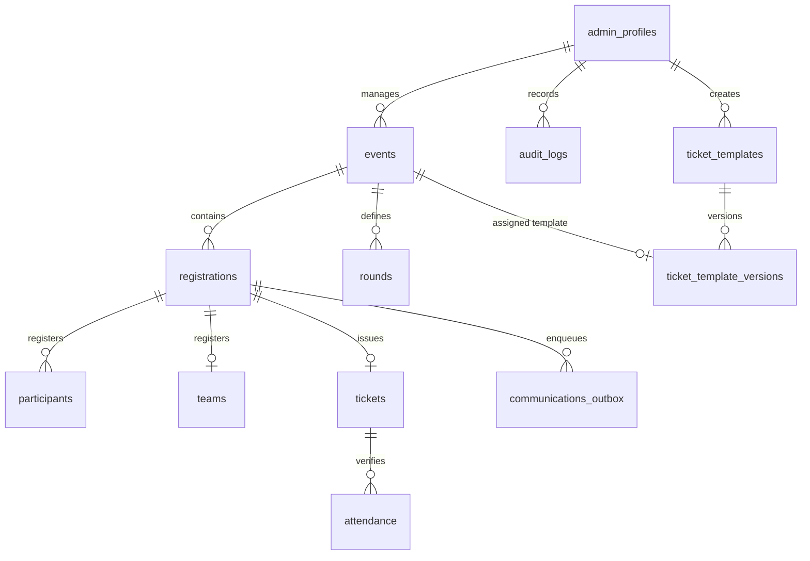
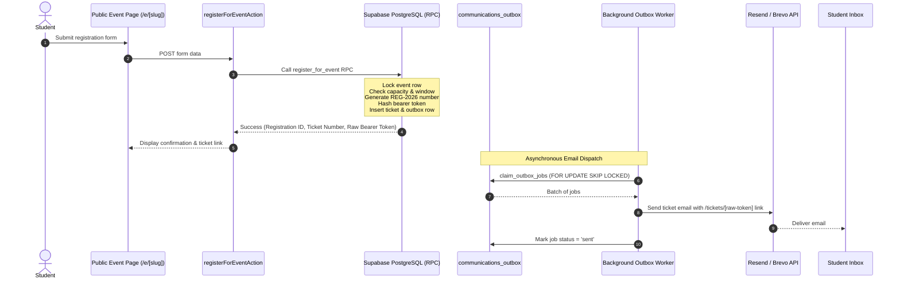
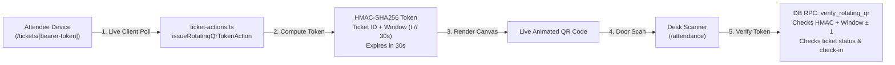

# SketchHUB — Technical Architecture & Technology Stack (`02-ARCHITECTURE-AND-TECH-STACK.md`)

> **Target Audience:** Tharika (Project Lead) & Technical Maintainers  
> **Repository:** [https://github.com/Hxrsh-ops/sketch-events-app](https://github.com/Hxrsh-ops/sketch-events-app)  
> **Source Evidence:** Verified directly from `package.json`, `src/lib/`, `src/app/`, and `supabase/migrations/`.

---

## 1. Verified Technology Stack & Dependency Versions

| Component | Technology | Exact Version | Purpose & Architecture Role |
|---|---|---|---|
| **Frontend Framework** | Next.js (App Router) | `16.3.8` | React Server Components (RSC), Server Actions, API Route Handlers. |
| **Core UI Library** | React & React DOM | `19.0.0` | Concurrent rendering, modern hooks, Actions API. |
| **Language** | TypeScript | `5.7.3` | Strict type checking (`tsc --noEmit`). |
| **Styling** | Tailwind CSS | `3.4.17` | Utility-first CSS with custom tokens and dark mode support. |
| **Animation** | Framer Motion | `14.0.0` | Micro-interactions, slide-overs, dynamic tab indicators. |
| **UI Primitives** | Radix UI Primitives | `^1.1.x` - `^2.1.x` | Accessible headless components (Dialog, Tabs, Dropdown, Avatar, Tooltip). |
| **Icons** | Lucide React | `0.475.0` | Consistent iconography across admin and public views. |
| **QR Code Engine** | `qrcode` | `1.5.4` | Server and client-side high-density QR code matrix generation. |
| **Database & Identity** | Supabase JS & SSR | `@supabase/supabase-js: 2.49.1`<br/>`@supabase/ssr: 0.5.2` | Supabase Client, Auth cookie exchange, Server-side data repository. |
| **Security Guards** | `server-only` | `0.0.1` | Build-time enforcement ensuring backend secrets never leak to client bundles. |
| **Unit & E2E Testing** | Vitest | `5.0.3` | Fast automated test runner with mock and real DB execution. |
| **Linting** | ESLint & Next Plugin | `eslint: 9.20.0`<br/>`eslint-config-next: 16.3.8` | Code quality, React hooks rules, and style consistency. |

---

## 2. Next.js Routing Architecture

The application uses the Next.js 16 App Router with three route groups separating operational concerns:

```
src/app/
├── (admin)/                 # Authenticated Organizer Workspace (Protected by session middleware)
│   ├── page.tsx             # Master Dashboard (KPIs, active events, quick actions)
│   ├── analytics/           # Operational analytics and registration metrics
│   ├── attendance/          # Live QR check-in terminal and manual correction desk
│   ├── audit/               # Immutable operational audit logs
│   ├── certificates/        # Certificate eligibility, issuance, and template manager
│   ├── communications/      # Transactional outbox inspector and email telemetry
│   ├── events/              # Event directory, detail pages, and new event creation wizard
│   ├── exports/             # Sanitized CSV and JSON data export desk
│   ├── participants/        # Attendee roster, search, and status management
│   ├── rounds/              # Multi-stage round and competitive advancement desk
│   ├── settings/            # Administrative profile and system configurations
│   ├── studio/              # Ticket Studio visual design and template editor
│   ├── teams/               # Team roster management and member assignment
│   ├── layout.tsx           # Admin shell (desktop sidebar, top utility bar, mobile drawer)
│   └── loading.tsx          # Skeleton loading states for smooth route transitions
│
├── (auth)/                  # Administrative Authentication Portal
│   └── login/               # Cinematic split-screen admin login (Email/PW + Google OAuth)
│
├── (public)/                # Public Guest Experience (Zero authentication required)
│   ├── e/[slug]/            # Public event landing page and dynamic registration form
│   └── tickets/[token]/     # Live digital entry pass with 30-second rotating QR code
│
├── actions/                 # Authoritative Next.js Server Actions ("use server")
│   ├── certificate-actions.ts
│   ├── communication-actions.ts
│   ├── event-actions.ts
│   ├── export-actions.ts
│   ├── participant-actions.ts
│   ├── registration-actions.ts
│   ├── round-actions.ts
│   ├── search-actions.ts
│   └── ticket-actions.ts
│
└── api/                     # Specialized Route Handlers
    ├── auth/callback/       # Supabase OAuth PKCE exchange and admin profile verification
    ├── auth/preview-login/  # Preview mode dev login (locked in production)
    ├── auth/preview-logout/ # Preview mode session teardown
    ├── cron/process-outbox/ # Authenticated HTTP POST endpoint for background email processing
    └── events/count/        # Lightweight public event counter endpoint
```

---

## 3. Database Architecture & Core Tables

The PostgreSQL schema is managed via Supabase migrations (`supabase/migrations/`):



### Key Tables & Schema Invariants
1. `public.admin_profiles`:
   - Stores authorized administrators, roles (`master_admin`, `event_manager`, `attendance_staff`, `analyst`), and profiles.
   - Protected by RLS: revoked from public/anon. Bootstrapped via SQL Editor or Service Role.
2. `public.events`:
   - Holds event metadata, venue mode (`in-person`, `online`, `hybrid`), dates, seat capacity, registration windows, and assigned `ticket_template_version_id`.
3. `public.registrations`:
   - Authoritative ledger of event sign-ups. Holds unique registration number (`REG-2026-XXXXX-XXXXXX`), event ID, status (`confirmed`, `waitlisted`, `cancelled`), and metadata.
   - Enforces unique email per active event via constraint `uq_active_event_attendee_email`.
4. `public.participants` & `public.teams`:
   - Stores normalized attendee details (name, email, roll number, college) and optional team groupings.
5. `public.tickets`:
   - Issued exactly once per registration (`uq_registration_ticket`).
   - Stores unique human-readable ticket number and high-entropy `bearer_token_hash` (SHA-256).
   - The raw bearer token is never stored in plaintext in the database.
6. `public.ticket_templates` & `public.ticket_template_versions`:
   - Separates mutable template drafts from published immutable versions.
   - Stores canvas dimensions, theme colors, perforation stub settings, and background image URLs in `design_data JSONB`.
7. `public.attendance`:
   - Check-in log recording ticket ID, event ID, check-in timestamp, scanner actor ID, and method (`qr_scan` or `manual_override`).
   - Unique constraint `uq_event_ticket_attendance` prevents duplicate check-in records.
8. `public.communications_outbox`:
   - Transactional email queue storing recipient, template ID, subject, payload JSONB, status (`pending`, `processing`, `sent`, `failed`), attempts counter, and error logs.
9. `public.audit_logs`:
   - Immutable audit trail capturing actor, action string (e.g., `EVENT_PUBLISHED`, `ATTENDANCE_OVERRIDE`), target identifier, and JSON delta.

---

## 4. Database RPC Functions & Atomic Transactions

To prevent race conditions, critical state transitions are executed inside PostgreSQL stored procedures (`SECURITY DEFINER`):

| Stored Procedure (RPC) | Migration File | Purpose & Concurrency Guards |
|---|---|---|
| `public.register_for_event` | `00001`, `00002` | Atomic registration: acquires row-lock on `events`, validates registration window and capacity, inserts registration, participant, team, issues ticket, and enqueues outbox email in a single transaction. |
| `public.toggle_attendance` | `00004` | Atomic check-in/toggle: increments/decrements event check-in counters with row locks and creates audit entries. |
| `public.verify_rotating_qr` | `00007` | Verifies dynamic QR credentials: checks HMAC signature, validates 30s window with drift tolerance, verifies ticket active state, checks prior attendance, and marks check-in. |
| `public.claim_outbox_jobs` | `00003` | Concurrency-safe worker queue: claims up to $N$ pending jobs using `SELECT ... FOR UPDATE SKIP LOCKED` and transitions status to `processing`. |
| `public.finalize_event` | `00005` | Transitions event to completed, locks further registrations, and finalizes all rounds. |
| `public.revoke_ticket` | `00007` | Revokes an active ticket with mandatory audit logging and reason recording. |
| `public.search_organizer_records` | `00006` | High-performance full-text search across events, attendees, and tickets using unaccent and trgm indexes. |

---

## 5. Subsystem Deep-Dives

### 5.1 Registration-to-Ticket Lifecycle



### 5.2 Rotating QR Code Security Specification

Static QR codes are insecure for campus events because students screenshot passes and share them with unregistered friends. SketchHUB implements **rotating cryptographic QR credentials**:



1. **Windowed Token**: A 30-second time slice integer is computed: `Math.floor(Date.now() / 30000)`.
2. **HMAC Signature**: The server signs a payload containing `ticketId`, `eventId`, and `window` using a cryptographic secret (`CRON_SECRET` or dedicated key).
3. **Drift Tolerance**: The verification RPC accepts the current window and $\pm 1$ adjacent window (allowing a total 90-second valid window to accommodate minor clock drift on attendee phones).
4. **Replay Protection**: The database checks that the ticket has not already been scanned. A second scan immediately alerts door staff with `ALREADY_CHECKED_IN` and displays the exact prior check-in time and scanner name.

### 5.3 Transactional Email Infrastructure

The email engine (`src/lib/email/`) is decoupled from vendor SDKs via a clean adapter pattern:
- **`EmailAdapter` Interface**: Defines `send(options: EmailDispatchOptions): Promise<EmailDispatchResult>`.
- **Adapters**:
  - `ResendEmailAdapter`: Dispatches via `https://api.resend.com/emails`.
  - `BrevoEmailAdapter`: Dispatches via `https://api.brevo.com/v3/smtp/email`.
  - `MailpitEmailAdapter`: Posts to local Mailpit HTTP API at `http://127.0.0.1:54324/api/v1/send`.
  - `TestEmailAdapter`: Stores sent messages in-memory for unit tests.
- **Worker Resilience**: The worker processes batches of 10 jobs. Transient network failures increment `attempts` and calculate exponential backoff (`now + 2^(attempts) * 60s`). Permanent failures (e.g. invalid email address) transition status directly to `failed`.

---

## 6. Important Source Files & Responsibilities

| File Path | Primary Responsibility |
|---|---|
| `src/lib/env.ts` | Client-safe environment parser and production safety validation. |
| `src/lib/env.server.ts` | Server-only secret access protected by `server-only` build boundary. |
| `src/lib/supabase/client.ts` | Browser-side Supabase client for public subscriptions and client auth. |
| `src/lib/supabase/server.ts` | Server-side Supabase client with cookie management and privileged admin client. |
| `src/lib/supabase/repository.ts` | Core database abstraction (87KB); handles data queries, RPC calls, and mock fallbacks. |
| `src/lib/auth/session.ts` | Server-side admin verification and role assertion. |
| `src/lib/auth/temporary-admin.ts` | Preview dev login utilities (permanently disabled in production). |
| `src/lib/ticket/rotating-qr.ts` | Cryptographic HMAC generation and client QR rendering utilities. |
| `src/lib/email/worker.ts` | Transactional outbox claiming, batch dispatching, and retry backoff loop. |
| `src/lib/email/adapters.ts` | Provider adapters for Resend, Brevo, Mailpit, and Test. |
| `src/components/ticket/unified-ticket-card.tsx` | Single canonical component for rendering tickets across Studio, Live Pass, and Email. |
| `src/app/actions/registration-actions.ts` | Public server action for individual and team registration. |
| `src/app/actions/ticket-actions.ts` | Ticket Studio templates, background uploads, version publishing, and QR issuance. |
| `src/app/api/cron/process-outbox/route.ts` | HTTP POST webhook for background outbox cron processing. |

Proceed to [**03-LOCAL-SETUP-AND-TROUBLESHOOTING.md**](./03-LOCAL-SETUP-AND-TROUBLESHOOTING.md) to set up and run SketchHUB on your local machine.
