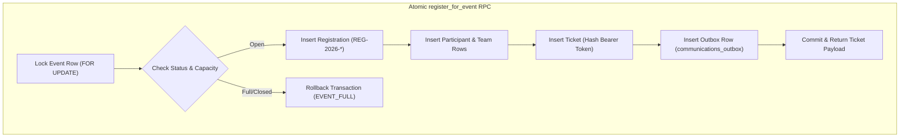

# SketchHUB — Supabase Database Architecture & Migrations Handover (`06-SUPABASE-DATABASE-AND-MIGRATIONS.md`)

> **Target Audience:** Tharika (Project Lead) & Database Engineers  
> **Source Evidence:** Verified directly from `supabase/config.toml` and `supabase/migrations/00001_initial_schema.sql` through `00008_ticket_storage_bucket.sql`.  
> **CRITICAL SAFETY DIRECTIVE:** Do NOT run remote database migrations or push unverified schema changes during handover. Perform read-only verification only.

---

## 1. Project Configuration & Environments

SketchHUB strictly decouples the local development database from the remote hosted Supabase project:

| Attribute | Local Development (Docker) | Remote Staging / Production |
|---|---|---|
| **Host / Platform** | Local Docker Engine (Windows WSL2) | Supabase Cloud (Hosted AWS) |
| **Project Ref** | `SKETCH_EVENTS_APP` (from `config.toml`) | `fvnkhzlbvxemwlkmwhbz` *(historical)* |
| **Organization** | Local | `SKETCHUB` *(historical)* |
| **Cloud Region** | N/A (Localhost) | `ap-south-1` (Mumbai, India) |
| **PostgreSQL Version** | 17 (from `config.toml major_version = 17`) | PostgreSQL 17 / Cloud managed |
| **API Gateway URL** | `http://127.0.0.1:54321` | `https://fvnkhzlbvxemwlkmwhbz.supabase.co` |
| **Postgres Port** | `127.0.0.1:54322` | Port `5432` / Cloud Connection Pooler `:6543` |
| **Supabase Studio** | `http://127.0.0.1:54323` | `https://supabase.com/dashboard/project/fvnkhzlbvxemwlkmwhbz` |
| **SMTP / Mailpit** | `http://127.0.0.1:54324` | Real Email Provider (Resend) |

---

## 2. Complete Migration Inventory & Remote Parity Status

All database changes are tracked version-by-version in `supabase/migrations/`:

| Migration File | Size | Purpose & Core Changes | Local Status | Remote Parity Status |
|---|---|---|---|---|
| `00001_initial_schema.sql` | 29.1 KB | Base schema: `admin_profiles`, `events`, `registrations`, `participants`, `teams`, `attendance`, `rounds`, `communications_outbox`, `audit_logs`. Base RLS policies. | Applied | Applied (Migrations 00001–00006 pushed) |
| `00002_strengthen_registration_numbers.sql` | 12.5 KB | Registration numbering format: `REG-2026-XXXXX-XXXXXX`. Fixes atomic sequence formatting in `register_for_event` RPC. | Applied | Applied |
| `00003_atomic_outbox_claiming.sql` | 1.5 KB | Stored procedure `claim_outbox_jobs`: uses `SELECT ... FOR UPDATE SKIP LOCKED` to prevent duplicate worker job processing. | Applied | Applied |
| `00004_atomic_attendance_toggle.sql` | 9.1 KB | Stored procedure `toggle_attendance`: atomic check-in counter increment/decrement and audit logging. | Applied | Applied |
| `00005_atomic_event_completion.sql` | 2.0 KB | Stored procedure `finalize_event`: finalizes rounds and archives active event registrations. | Applied | Applied |
| `00006_production_security_hardening.sql` | 22.4 KB | Search function security: creates `search_organizer_records`, enables unaccent/trgm indexes, locks unprivileged RLS. | Applied | Applied |
| `00007_ticket_studio_and_rotating_qr.sql` | 19.1 KB | Ticket Studio: creates `ticket_templates`, `ticket_template_versions`, `tickets` ledger, RPC `verify_rotating_qr`, and `revoke_ticket`. Seeds starter cinematic template. | Applied | ⚠️ **PENDING REMOTE VERIFICATION** (Reported as NOT YET pushed to remote) |
| `00008_ticket_storage_bucket.sql` | 2.1 KB | Storage: provisions public bucket `ticket-assets` (5MB limit, JPEG/PNG/WebP), public read policy, and admin upload policy. | Applied | ⚠️ **PENDING REMOTE VERIFICATION** (Reported as NOT YET pushed to remote) |

> [!CAUTION]
> **CRITICAL HANDOVER CHECK: MIGRATIONS 00007 & 00008**  
> Prior implementation reports confirm that migrations `00001` through `00006` were successfully pushed to remote project `fvnkhzlbvxemwlkmwhbz`. However, **migrations `00007` and `00008` were created recently and reported as not yet applied to the remote database.**
> 
> Before deploying any code that references Ticket Studio or rotating QR codes to production, Tharika must verify remote migration parity using the command below.

---

## 3. How to Check Remote Migration Parity (Read-Only)

Once Tharika receives access to the remote Supabase project:

```powershell
# 1. Log in to Supabase CLI with your own account
npx supabase login

# 2. Link your local repository to the remote project (READ ONLY)
npx supabase link --project-ref fvnkhzlbvxemwlkmwhbz

# 3. Compare local migration files against remote migration history
npx supabase migration list
```

The output will display a table comparing **Local** migration files against **Remote** applied status:
- If `00007` and `00008` are marked `Not Applied` on Remote, they must be planned for deployment.
- **DO NOT** run `npx supabase db push` until a complete remote database backup is verified!

---

## 4. Key Stored Procedures (RPCs) & Invariants



### Stored Procedure Reference Table

| Procedure Name | Security Level | Parameters | Invariants Enforced |
|---|---|---|---|
| `public.register_for_event` | `SECURITY DEFINER` | `p_event_id`, `p_attendee_email`, `p_attendee_name`, `p_attendee_phone`, `p_custom_data`, `p_team_name`, `p_team_members` | Strict row-lock on event; duplicate email rejection (`uq_active_event_attendee_email`); registration count increment; ticket issuance; atomic outbox queue insertion. |
| `public.verify_rotating_qr` | `SECURITY DEFINER` | `p_event_id`, `p_token_payload`, `p_actor_id`, `p_mode` | Validates HMAC signature with server secret; checks 30s window with $\pm 1$ drift; checks ticket status is `active`; rejects duplicate check-ins (`ALREADY_CHECKED_IN`); records attendance row. |
| `public.toggle_attendance` | `SECURITY DEFINER` | `p_event_id`, `p_ticket_id`, `p_actor_id`, `p_action`, `p_reason` | Idempotent check-in/checkout toggle; increments or decrements event checked-in counter; records audit log with reason. |
| `public.claim_outbox_jobs` | `SECURITY DEFINER` | `p_batch_size`, `p_lock_seconds` | Selects oldest pending or retryable jobs with `FOR UPDATE SKIP LOCKED`; marks status = `processing`; sets lock expiration to prevent zombie jobs. |
| `public.revoke_ticket` | `SECURITY DEFINER` | `p_ticket_id`, `p_actor_id`, `p_reason` | Sets ticket status to `revoked`; invalidates future QR verifications; writes audit log. |
| `public.finalize_event` | `SECURITY DEFINER` | `p_event_id`, `p_actor_id` | Sets event status to `completed`; locks rounds; prevents subsequent registrations. |
| `public.search_organizer_records` | `SECURITY DEFINER` | `p_query`, `p_limit` | Trigram and unaccent fuzzy search across events, attendees, and tickets. Revoked from public. |

---

## 5. Storage Buckets & Policies

Migration `00008_ticket_storage_bucket.sql` provisions Supabase Storage for Ticket Studio:

| Bucket Name | Visibility | File Size Limit | Allowed MIME Types | Security Policies |
|---|---|---|---|---|
| `ticket-assets` | **Public** | 5,242,880 bytes (5MB) | `image/jpeg`, `image/png`, `image/webp` | **Read:** Publicly accessible via CDN URL.<br/>**Upload (INSERT):** Restricted to authenticated admins (`public.is_admin()`) or `service_role`.<br/>**Update / Overwrite (UPDATE):** STRICTLY DISALLOWED (`USING (false)` to preserve immutable version history). |

---

## 6. Database Backup & Disaster Recovery

Before any remote migration deployment or major release:

### 1. Manual Backup via Supabase Dashboard
1. Open [https://supabase.com/dashboard/project/fvnkhzlbvxemwlkmwhbz/database/backups/scheduled](https://supabase.com/dashboard/project/fvnkhzlbvxemwlkmwhbz/database/backups/scheduled).
2. Verify that automated daily backups are active.
3. Click **Create Manual Backup** before executing schema updates.

### 2. CLI SQL Dump Backup
You can export a logical SQL dump using the Supabase CLI:

```powershell
# Logical dump of schema and data
npx supabase db dump --project-ref fvnkhzlbvxemwlkmwhbz -f "backup-$(Get-Date -Format 'yyyyMMdd-HHmm').sql"
```

---

## 7. Applying Remote Migrations (Safe Execution Plan)

When Tharika and the team are ready to apply migrations `00007` and `00008` to the remote project:

1. **Prerequisite 1:** Verify manual database backup completed in Supabase Dashboard.
2. **Prerequisite 2:** Announce a maintenance window if attendees are actively registering.
3. **Execution Command:**
   ```powershell
   npx supabase db push --linked
   ```
4. **Post-Migration Verification:**
   ```powershell
   npx supabase migration list --linked
   ```
   Confirm all 8 migrations show `Applied`.
5. **Verify Storage Bucket:**
   Open Supabase Dashboard &rarr; **Storage** &rarr; confirm `ticket-assets` bucket exists with public read enabled.

Proceed to [**07-FEATURE-STATUS-AND-TEST-EVIDENCE.md**](./07-FEATURE-STATUS-AND-TEST-EVIDENCE.md) to review the comprehensive audit of features and test results.
