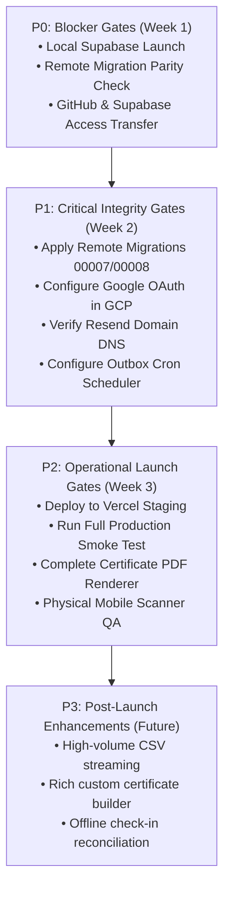

# SketchHUB — Prioritized Roadmap & Release Gates (`09-ROADMAP-AND-RELEASE-CHECKLIST.md`)

> **Target Audience:** Tharika (Project Lead) & Engineering Team  
> **Source Evidence:** Derived from codebase audit, unverified external integrations, and missing production configurations.  
> **Production Status:** **Pre-Release Staging**. The codebase is functionally mature, but cannot be classified as production-ready until remote migrations are synchronized and external cloud credentials are live.

---

## 1. Prioritized Engineering Roadmap

---

### Priority P0: Blockers to Running or Safely Maintaining (Immediate)

These items must be resolved before Tharika begins writing new features:

| Task ID | Description | Acceptance Criteria | Dependencies | Owner |
|---|---|---|---|---|
| **P0-1** | **Transfer GitHub & Supabase Access** | Tharika has Admin rights on GitHub repository (`Hxrsh-ops/sketch-events-app`) and Owner/Admin rights in Supabase Organization `SKETCHUB`. | Harshanth invites `tharikadheena@gmail.com`. | Harshanth / Tharika |
| **P0-2** | **Verify Local Docker Supabase Stack** | Running `npx supabase start` on Tharika's Windows machine boots all containers; `npx supabase migration list` reports all 8 migrations applied; running `npm test` passes `ticket-background-upload.test.ts`. | Docker Desktop with WSL2 running on local laptop. | Tharika |
| **P0-3** | **Check Remote Migration Parity** | Run `npx supabase migration list --linked` against remote project `fvnkhzlbvxemwlkmwhbz` to confirm the exact status of migrations `00007` and `00008`. | Supabase CLI linked to remote project. | Tharika |
| **P0-4** | **Sync Git Branches** | Merge or rebase active work from `feat/harshanth-main-development` into `master` or maintain clean tracking branch. | Code review of uncommitted changes. | Tharika / Harshanth |

---

### Priority P1: Critical Lifecycle, Security & Data-Integrity (Pre-Production)

These items must be resolved before accepting real student registrations:

| Task ID | Description | Acceptance Criteria | Dependencies | Owner |
|---|---|---|---|---|
| **P1-1** | **Apply Remote Migrations 00007 & 00008** | Migrations `00007` (Ticket Studio & Rotating QR) and `00008` (Storage Bucket) are applied cleanly to remote Supabase project. Table `public.tickets` and storage bucket `ticket-assets` exist on remote. | P0-3 completed; manual remote DB backup created. | Tharika |
| **P1-2** | **Configure Production Google Cloud OAuth** | Google Cloud Console OAuth Client has authorized origins matching the production domain, and redirect URI `https://<project-ref>.supabase.co/auth/v1/callback`. Google sign-in works on production URL. | Canonical domain chosen. | Tharika / Harshanth |
| **P1-3** | **Verify Sender Domain in Resend** | DNS records (MX, TXT SPF, CNAME DKIM) added to club domain registrar; Resend dashboard displays `Verified`; test email sent via Resend API. | Access to domain DNS manager. | Tharika |
| **P1-4** | **Configure Automated Outbox Cron Scheduler** | External cron service (Upstash QStash or Google Cloud Scheduler) configured to send `POST https://<prod-domain>/api/cron/process-outbox` with `Authorization: Bearer <CRON_SECRET>` every 60 seconds. | Production deployment URL active. | Tharika |

---

### Priority P2: Operational Reliability & Launch Preparation

These items ensure smooth event-day operations:

| Task ID | Description | Acceptance Criteria | Dependencies | Owner |
|---|---|---|---|---|
| **P2-1** | **Deploy to Vercel Production Environment** | Vercel project connected to GitHub repository; all environment variables configured; `npm run build` succeeds on Vercel edge; zero secret leakage. | P1-1 through P1-4 complete. | Tharika |
| **P2-2** | **Execute Full Production Smoke Test** | Complete the 10-point production smoke test checklist (see Section 2 below) using live attendee emails on smartphones. | P2-1 complete. | Tharika / Team |
| **P2-3** | **Complete Certificate PDF Generation** | Certificate view (`/certificates`) wired to generate downloadable PDF files or vector SVG certificates for checked-in attendees. | Attendance records verified. | Developer / Lead |
| **P2-4** | **Mobile Door Scanner Field QA** | Test attendance check-in terminal on iOS Safari and Android Chrome using phone cameras; verify camera permission handling and audio scan feedback. | Smartphone hardware. | Tharika |

---

### Priority P3: Post-Launch Enhancements & Future Features

- **P3-1: High-Volume Streamed CSV Exports**: Stream large attendance rosters directly from PostgreSQL using node streams to prevent memory spikes on events with >5,000 attendees.
- **P3-2: Visual Certificate Builder in Studio**: Extend Ticket Studio canvas to support drag-and-drop certificate layout design.
- **P3-3: Offline QR Reconciliation**: For campus venues with completely dead cellular reception, design an offline signed JWT voucher model with post-event synchronization.

---

## 2. Staging & Production Release Gate Checklist

Do not announce or launch SketchHUB until every checkbox in this gate is verified:

### Phase A: Database & Infrastructure Gates
- [ ] Remote Supabase project backup verified in dashboard.
- [ ] `npx supabase migration list --linked` reports all 8 migrations `Applied` on remote database.
- [ ] Supabase Storage bucket `ticket-assets` verified with Public Read policy.
- [ ] Initial master administrator profile bootstrapped in remote `public.admin_profiles`.

### Phase B: Auth & Communications Gates
- [ ] Google OAuth login redirects cleanly from production domain and lands in dashboard.
- [ ] Attempting to log in with an unauthorized Google email returns `error=not_an_admin`.
- [ ] Outbox cron endpoint `/api/cron/process-outbox` returns `HTTP 405` on `GET` and `HTTP 401` on unauthenticated `POST`.
- [ ] Sending a test registration produces an outbox job that transitions to `status = 'sent'` within 60 seconds.
- [ ] Transactional ticket email received in an external Gmail inbox with high deliverability (not in spam folder).

### Phase C: Attendee Pass & Door Check-In Gates
- [ ] Clicking the ticket link in email opens `/tickets/[token]` cleanly on mobile without requiring any login.
- [ ] Rotating QR code refreshes every 30 seconds on the mobile ticket pass.
- [ ] Scanning the QR code from the `/attendance` scanner marks the participant checked in.
- [ ] Scanning the same QR code a second time immediately triggers `ALREADY_CHECKED_IN` warning.
- [ ] Event checked-in count increments accurately on the Master Dashboard.

Proceed to [**10-TEAM-LEAD-OPERATING-GUIDE.md**](./10-TEAM-LEAD-OPERATING-GUIDE.md) to inspect day-to-day lead operating procedures and AI prompt workflows.
